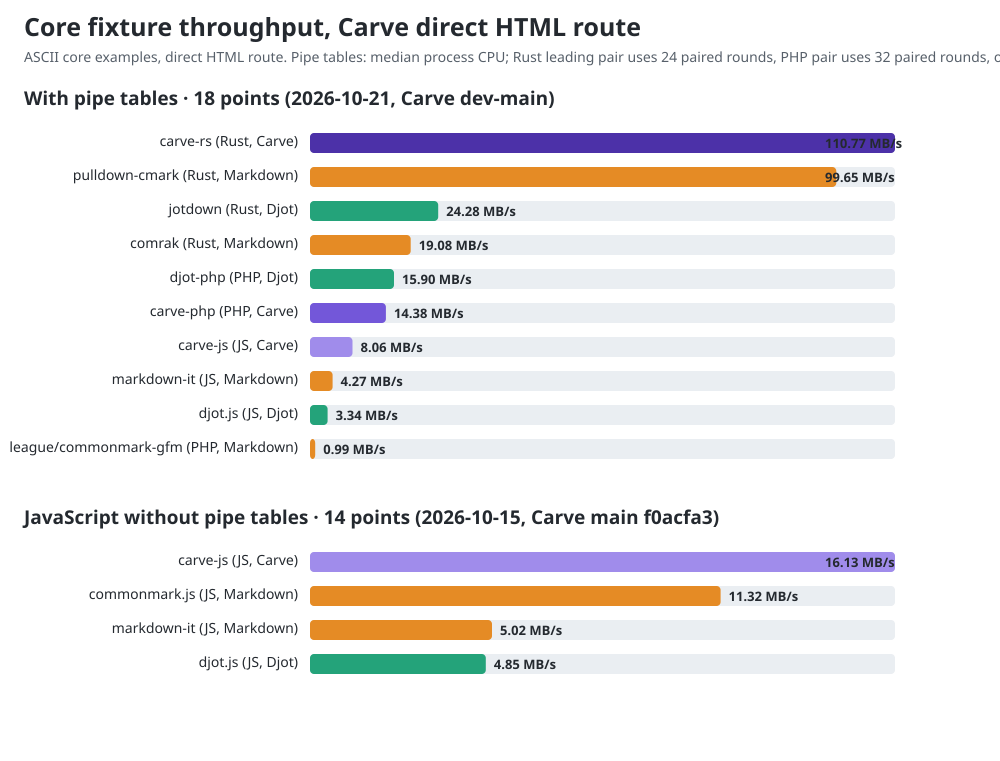
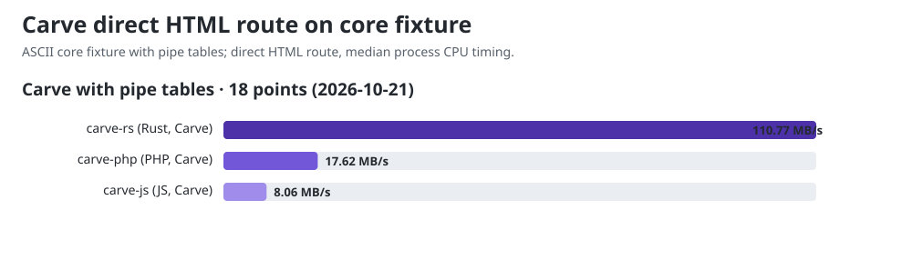

# carve-bench

Performance benchmarks for the [Carve](https://github.com/markup-carve/carve)
markup engines. Each engine renders the same documents to HTML in-process, many
times, and reports throughput. This is a **speed** comparison - every engine
passes the same [conformance corpus](https://github.com/markup-carve/carve/tree/main/tests/corpus),
so correctness is not what is being measured here.

Engines covered: [carve-js](https://github.com/markup-carve/carve-js) (TypeScript),
[carve-php](https://github.com/markup-carve/carve-php) (PHP),
[carve-rs](https://github.com/markup-carve/carve-rs) (Rust). The carve-go /
carve-py / carve-rb bindings wrap the carve-rs engine, so their core render speed
tracks carve-rs plus a thin FFI/IPC layer.

## JavaScript comparison including commonmark.js

The [shared JavaScript core report](reports/commonmark-js.md) compares Carve,
Djot, markdown-it and commonmark.js 0.31.2 on equivalent content without pipe tables.
Its runner checks projected HTML before timing and records two reversed-order rounds,
plus a CommonMark parser/renderer constructor control. This 14-point workload
is separate from the 18-point comparison with pipe tables below.
The all-engines chart shows final values in a separate panel without pipe tables; the
interactive site view also includes commonmark.js under All languages and JavaScript.
Final values use median timing across all samples from both rounds. The raw
report retains the individual rounds. Different content mixes change each library's conversion cost. Compare within each workload; engine versions and commits are recorded in the report.

The 15 October comparison measured Carve JS merged main `f0acfa3` against released
peers. The [0.1.9 snapshot](reports/commonmark-js-release-0.1.9.md)
remains available. To reproduce merged main, use the pinned checkout command
in the report; the runner verifies its ancestry, clean source and fast-path use.

Run `npm ci` in `engines/js`, then `node scripts/compare-commonmark.mjs`
from the repository root. Generate its chart with `node scripts/gen-charts.mjs`.

## October 6 and 7 engine audits

The refreshed merged-main reports include the AST comparison, patch replay,
provenance and envelope fixes in [JS #2551](https://github.com/markup-carve/carve-js/pull/2551),
[PHP #2921](https://github.com/markup-carve/carve-php/pull/2921) and
[Rust #2345](https://github.com/markup-carve/carve-rs/pull/2345).
The current chart also includes the parser follow-ups [JS #2555](https://github.com/markup-carve/carve-js/pull/2555),
[PHP #2927](https://github.com/markup-carve/carve-php/pull/2927) and the URL-allocation fix
[Rust #2351](https://github.com/markup-carve/carve-rs/pull/2351).
The current reports include the whitespace follow-up [JS #2560](https://github.com/markup-carve/carve-js/pull/2560),
the packed fence index [PHP #2930](https://github.com/markup-carve/carve-php/pull/2930),
adjacent-text joins and padding scans [PHP #2931](https://github.com/markup-carve/carve-php/pull/2931),
and collection pacing [PHP #2932](https://github.com/markup-carve/carve-php/pull/2932).
The refresh also includes candidate queues and import lookups [JS #2565](https://github.com/markup-carve/carve-js/pull/2565),
renderer queues and import caches [PHP #2935](https://github.com/markup-carve/carve-php/pull/2935),
and swatch classes, ordered attributes and backlink names [Rust #2357](https://github.com/markup-carve/carve-rs/pull/2357).
This refresh also includes native image and table fixes in [JS #2578](https://github.com/markup-carve/carve-js/pull/2578) and [#2580](https://github.com/markup-carve/carve-js/pull/2580), [PHP #2951](https://github.com/markup-carve/carve-php/pull/2951) and [#2953](https://github.com/markup-carve/carve-php/pull/2953), and [Rust #2365](https://github.com/markup-carve/carve-rs/pull/2365) and [#2369](https://github.com/markup-carve/carve-rs/pull/2369).
Those PRs record focused timings for the affected APIs. The throughput and
history workloads here measure conversion and import routes.

The audits cover the paths recorded in the linked PRs. Their results do not
prove linearity over every input. Sibling matching retains a quadratic LCS
step capped at one million candidate pairs. Repeated front edits in arbitrary
JSON patches can shift arrays, and JS resolver callbacks that mutate input
require comparison-cache invalidation. The PHP PR documents the flat identity tradeoff alongside its deep-case gains.

## Results

The [**benchmark site**](https://markup-carve.github.io/carve-bench/) presents the
same reports with language filters and downloadable charts. See the
[site build instructions](site/README.md) to reproduce it locally.

The throughput charts use pinned merged commits for JS, PHP and Rust. The core snapshot was measured 2026-10-15 UTC on CPU 13; the PHP and Rust leading pairs have later rechecks. See [the source commits and samples](reports/dev-main-core.md).
The direct HTML tables and pipe-table charts use median process CPU time. The two leading Rust rows use a [24-round paired recheck](reports/rust-core-recheck-20261021-rerun.md) of the same binary. The PHP Carve and Djot rows use a [32-round lower-load recheck](reports/php-core-quiet-20261021.md) of merged carve-php. Other rows use fourteen samples in two rounds with reversed engine order. The original wall-time snapshot remains in [the dev-main report](reports/dev-main-core.md).
The shared host's one-minute load changed from 7.83 to 9.78 during the core run.
These sessions do not isolate code effects across snapshots.
The report retains fixed merged-main snapshots containing the completed Djot importer fixes. Later main commits are recorded as observations and are outside this measurement.
The PHP peer uses Djot master `77e5b6c`, after the merged performance fixes. Exact sources are recorded in the report.
Historical release results remain in [COMPARISON.md](COMPARISON.md).
The [pre-refresh core report](reports/dev-main-core-pre-postfix-20261015.md),
[full-corpus record](reports/dev-main-full-pre-postfix-20261015.json),
and [PHP tier follow-up](reports/php-tier-pairs-pre-postfix-20261015.md)
preserve the previous merged-main snapshot.
The September 30 development-main snapshot, taken after the PHP
parser and renderer changes and naming its exact commits and input hashes, is in
[the refresh report](reports/performance-refresh.md).
The [October 15 three-engine checkup](reports/engine-checkup-2026-10-15.md) compares pinned and merged-main revisions with paired timing, memory, and allocation samples.

The table below records the core route: the default conversion API with **no
opt-in extensions registered**, against the fastest same-language peer.

| Language | Carve | MB/s | Fastest peer | MB/s | Carve vs peer |
|---|---|---:|---|---:|---:|
| Rust | carve-rs | 110.77 | pulldown-cmark | 99.65 | 1.11x |
| JavaScript | carve-js | 8.06 | markdown-it | 4.27 | 1.89x |
| PHP | carve-php | 17.62 | djot-php | 17.58 | 1.00x |





Carve development-main engines on the identical document:

| Engine | Language | ms/op | MB/s | rel |
|---|---|---:|---:|---:|
| carve-js | JavaScript | 7.4145 | 8.06 | 13.75x |
| carve-php | PHP | 3.3906 | 17.62 | 6.29x |
| carve-rs | Rust | 0.5392 | 110.77 | 1.00x |

The [core snapshot](reports/dev-main-core.json), [Rust paired recheck](reports/rust-core-recheck-20261021-rerun.json), and [PHP lower-load recheck](reports/php-core-quiet-20261021.json) contain the displayed samples and source identities. The [earlier PHP recheck](reports/php-core-recheck-20261021.md) remains available with its higher-load second session.
Historical release rows and capability scoring remain in [COMPARISON.md](./COMPARISON.md).

The published numbers are split into four tracks:

| Track | Question | Route | Peers |
|---|---|---|---|
| A: [direct HTML conversion](reports/dev-main-core.md) | How fast are the measured core examples through the default API? | Direct HTML route for these inputs | Same-language Djot/CommonMark libraries |
| B: [full corpus and configured tiers](./RESULTS.md) | How does the whole language scale, and what do opt-in extensions cost? | Mixed 2,134-document corpus plus PHP Tier 1/2/3 | Carve implementations and internal tiers |
| C: [structured document conversion](reports/realistic-engine.md) | How do pinned merged-main engines convert complete documentation files? | Full parse (AST) on three fixed public documents | Carve JavaScript, PHP, and Rust |
| D: [authored documents against peers](reports/realistic-peer.crv) | How do the AST routes compare with same-language libraries on complete documents? | Carve AST route; peer libraries' normal HTML APIs | Djot and Markdown libraries in JavaScript, PHP, and Rust |

The tracks use different inputs and routes. A Track-A library may avoid an
owned public AST; Track B measures a concatenated stress input, and Track C
measures complete authored documents that require full parsing in each engine.
Track D uses three authored documents in native Carve, Djot, and Markdown
formats. Its output projection checks matching rendered content; the peer APIs
may use different internal representations and support different grammars.
Competitors are absent from the full Carve corpus because they do not implement
equivalent syntax there, so such rows would measure literal/error recovery
rather than equal work.

Every table in both documents is regenerated by `compare.mjs` / `run.mjs`; no
row is transcribed by hand, including the PHP tier table.

The historical `COMPARISON.md` tables measure the pinned published releases.
The current `RESULTS.md` tables measure the same merged main commits as the core
report, using runtime checkout overrides. The [full-run record](reports/dev-main-full.json)
contains worker results, source commits, input hashes and runtime settings.

Track C freezes three public documentation files after conversion with the pinned
JavaScript Markdown importer. The [provenance](corpus/realistic/provenance.json)
records both source and fixture hashes. Each pinned engine's route probe must
report full parse before timing. To rerun the snapshot, set
`CARGO_TARGET_DIR=/var/tmp/cargo-shared/carve-bench`, then run
`python3 scripts/realistic/run.py --cpu 14` and
`python3 scripts/realistic/output-control.py`, then
`node scripts/realistic/report.mjs`. The runner builds pinned engine sources in
`.realistic-cache`, excludes process startup, and records every sample in
[realistic-engine.json](reports/realistic-engine.json). The chart uses process
CPU time; the raw record also keeps elapsed wall time for each conversion.
To verify fixture conversion, use a built carve-js checkout at the
`migrator_commit` in [provenance](corpus/realistic/provenance.json), then run
`node scripts/realistic/fixtures.mjs <carve-repo> <migrator-checkout> --check`.
The migrator commit is separate from the JavaScript engine pin used for timing.

Track D has its own [engine pins](scripts/realistic/peer-pins.json) and
[fixture provenance](corpus/realistic/peer/provenance.json). The
[report](reports/realistic-peer.crv) links the raw process CPU samples and AST
route checks. `peer-fixtures.mjs` verifies the three input formats;
`peer-route-check.mjs` checks the Carve routes; `peer-run.mjs` checks projected
HTML and records rotating timing rounds. The published comparison combines
three recorded sessions (4, 4, and 8 rounds) with `peer-aggregate.mjs`;
`peer-report.py` and `peer-chart.mjs` rebuild the report and chart from the
combined record. The runners
take pinned checkout paths through `CARVE_JS_TREE`, `CARVE_PHP_TREE`, and
`CARVE_RS_TREE`; the comparison runner also takes `CARVE_RS_COMPARE_BIN`.

The [historical final-audit paired comparison](reports/final-audit-pairs.md) retains
the preceding published snapshot and the merged-main commits it measured. Its
[producer archive](reports/producers/README.md) preserves the measured tooling.
It alternates revision order across eight rounds and requires matching HTML hashes.
The [exact-input controls](reports/final-audit-conversion-checks.md) check the core and corpus inputs
in two reversed rounds. They suppress timing changes when outputs differ, timed windows are short,
or observed changes are smaller than same-revision drift. These paired sessions do not establish
statistical significance.

The historical [paired full-feature comparison](reports/paired-full-feature.md) measures old
and new merged commits in the same session. It checks exact HTML hashes within
each engine before timing, alternates run order, and uses the same CPU affinity
for both revisions. Its observed per-round ratios and ranges cover both gains
and costs; they are not significance tests. The change column is the median of per-round ratios, which can differ from the
ratio of the two median times. Its closed-block fixture exercises formatting, quotations,
nested lists, definition lists, tables, code, raw HTML and footnotes.

The concatenated conformance corpus is a stress workload. Independent examples
can interact through open fences, containers and definitions when joined into
one document. A correctness fix can change the output size and nesting, so these
historical snapshots cannot establish a speed regression when output hashes or
CPU settings differ.

To reproduce a paired run, install the locked dependencies and provide a local
JSON config with `before` and `after` maps. Include `baseline_benchmark_commit`, identifying the prior published full-corpus
report whose source pins define before. Each map contains `js`, `php` and `rs`
entries with an absolute checkout `path` and full merged `commit`. Run:

```sh
taskset -c CPU node scripts/compare-full-feature.mjs CONFIG.json
```

On Linux, choose an available CPU for `CPU`. The runner builds both revisions
before timing, rejects pairs with different HTML, exports portable metadata and
archives a prior committed paired report before replacing it. Keep CPU affinity and runtime settings unchanged across the pair. Pinning to one CPU
also limits Node's compiler and GC threads; its results must not be compared
directly with older unrestricted runs.

Published paired reports are checked against the recorded producer hashes.
Changing a measured producer requires a fresh run before publishing the new
producer and report. The exporter applies the standard portable metadata note;
a report may already contain no absolute paths.

The [exact-corpus revision checks](reports/conversion-snapshot-pairs.md) compare
the revisions in that paired report on the committed core, small, medium and large
inputs. JS also includes the core input without pipe tables. Two reversed
rounds use fixed iterations within each pair. PHP's large
input produces different HTML under the old revision's tracing JIT, so that
row has no comparable timing change. The [JIT output control](reports/php-large-jit-output-control.json)
records the old revision with JIT disabled and both revisions with tracing JIT.
It records output observations under those settings, without attributing a cause.

The [Rust ranking check](reports/rust-core-ranking.md) runs Carve and pulldown in
both Rust builds, alternating order across eight rounds. Both checks retain
samples and source hashes. They measure the pinned audit revisions, before
later parser follow-ups, and do not establish statistical significance.

The interim CPU 6 audit refresh is preserved in the [core report](reports/dev-main-core-audit-20261006.md),
[JS report](reports/commonmark-js-audit-20261006.md), [full-corpus record](reports/dev-main-full-audit-20261006.json)
and [Rust dependency lock](reports/dev-main-rust-audit-20261006.Cargo.lock).

To reproduce these historical checks, use benchmark commit `9ca2a44`, which retains
the original producer at its original filename. Add a fresh `artifact_directory` to the paired config. The
paired runner retains both Rust comparison binaries there. Then run:

```sh
taskset -c CPU python3 scripts/check-conversion-snapshots.py CONFIG.json --rust-binaries ARTIFACT_DIRECTORY
taskset -c CPU python3 scripts/check-rust-core-ranking.py --rust-binaries ARTIFACT_DIRECTORY --core-controls reports/dev-main-core-audit-20261006.json
python3 scripts/public_report.py reports/conversion-snapshot-pairs.json reports/rust-core-ranking.json
```

The original conversion-check producer is preserved in
`scripts/check-conversion-snapshots-pre-final-audit.py` as a byte-exact verification copy for the historical reports. Run it from its original
filename in the older benchmark checkout when reproducing those checks.
The current runner accepts `--php-memory-limit`; the final-audit controls use 512 MiB
for both revisions because the preceding PHP baseline exceeds 128 MiB on the large input.

The scripts check the binaries against the paired build manifest. Output and checkpoint paths
must be fresh. The first check also verifies JS build hashes and PHP settings.
Raw measurements remain local before portable publication.

To reproduce the current full-corpus snapshot, check out the commits named in
[the core report](reports/dev-main-core.md), build Carve JS, and build the Rust
worker with `node scripts/build-rs-engine.mjs --carve-rs /tmp/carve-rs-main`.
Then run serially with the checkout overrides:

```sh
CARVE_JS=/tmp/carve-js-main/dist/index.js \
CARVE_PHP_SRC=/tmp/carve-php-main/src \
CARVE_RS_SRC=/tmp/carve-rs-main \
CARVE_PHP_INI="-n -d extension=ctype -d extension=mbstring -d memory_limit=512M" \
CARVE_FULL_REPORT=reports/dev-main-full.json \
CARVE_RUN_META='Pinned merged-main benchmark after AST performance changes; CPU 13; PHP memory limit 512M.' \
CARVE_CORPUS_SNAPSHOT='carve 9db91206d1a4a8a8cf795c48210bca49d66f14d6 (2,134 documents); fixed committed corpus retained.' \
taskset -c 13 node run.mjs
node scripts/check-full-outputs.mjs /tmp/carve-main-config.json
python3 scripts/public_report.py reports/dev-main-full.json
node scripts/publish-full-notes.mjs
node scripts/gen-charts.mjs
```

The concatenated corpus run retains the prior 512 MiB PHP memory limit for comparable settings.
The following memory failure belongs to the preceding snapshot, before the packed-index and collection changes. The timed large-input warmup
at PHP commit `40653c424` exceeds the clean configuration's 128 MiB default
([failure and memory controls](reports/php-large-memory-control.json)); the core comparison
uses its recorded default settings.

Report freshness checks require a new measurement after changing the recorded
measurement code or dependency locks.

The runners record process CPU affinity. This refresh uses CPU 13 for the
core, full-corpus and history main measurements. The interim audit refresh
used CPU 6; release-tag history samples retain CPU 12.
Affinity also applies to Node compiler and GC threads. These shared-host
sessions do not isolate code changes.

The [preceding core snapshot](reports/dev-main-core-pre-audit-20261006.md),
[JS snapshot](reports/commonmark-js-pre-audit-20261006.md) and
[full-corpus raw record](reports/dev-main-full-pre-audit-20261006.json) retain
the previous measurements.

The [preceding October 7 core snapshot](reports/dev-main-core-pre-final-audit-20261007.md),
[JS snapshot](reports/commonmark-js-pre-final-audit-20261007.md) and
[full-corpus raw record](reports/dev-main-full-pre-final-audit-20261007.json) preserve the measurements before the final JS and PHP follow-ups.

The [preceding queue-audit core snapshot](reports/dev-main-core-pre-queue-audit-20261007.md),
[JS snapshot](reports/commonmark-js-pre-queue-audit-20261007.md),
[full-corpus record](reports/dev-main-full-pre-queue-audit-20261007.json) and
[history record](reports/engine-history-pre-queue-audit-20261007.json) preserve the reports before the queue and import fixes.
Their paired measurements remain in [the preceding controls](reports/final-audit-conversion-checks-pre-queue-audit-20261007.md).

The snapshot before this refresh is retained in the [core report](reports/dev-main-core-pre-table-import-20261008.md), [JS report](reports/commonmark-js-pre-table-import-20261008.md), [full corpus](reports/dev-main-full-pre-table-import-20261008.json), and [history](reports/engine-history-pre-table-import-20261008.json).
Its [paired measurements](reports/final-audit-pairs-pre-table-import-20261008.md) and [conversion controls](reports/final-audit-conversion-checks-pre-table-import-20261008.md) retain the earlier before/after evidence.
The earlier [output checks](reports/dev-main-full-output-controls-pre-table-import-20261008.json) and [Rust dependency lock](reports/dev-main-rust-pre-table-import-20261008.Cargo.lock) identify the corresponding output and build configurations.
The [core chart](charts/core-throughput-pre-table-import-20261008.svg), [Carve core chart](charts/carve-core-throughput-pre-table-import-20261008.svg), [full-corpus chart](charts/full-corpus-pre-table-import-20261008.svg), and [PHP tiers](charts/php-tiers-pre-table-import-20261008.svg) retain the previous values.

To refresh only merged main history points and retain release samples, use the
same pinned engine config as the core run:

```sh
python3 scripts/history/refresh-main.py /tmp/carve-main-config.json --cpu 13
python3 scripts/public_report.py reports/engine-history.json
python3 scripts/history/report.py reports/engine-history.json
```

The mixed corpus produces different HTML on published releases and current
main. See the [output checks and paired Rust control](reports/dev-main-full-output-controls.json)
before interpreting cross-version full-corpus timings as speed changes.


The historical [PHP snapshot check](docs/php-snapshot-check.md) compares two
pre-improvement commits with identical PHP source trees. It does not cover the
parser and renderer changes measured here.

To reproduce the current throughput tables, use [the pinned main runner](reports/dev-main-core.md#reproduce).
The 150-section fixture differs from the historical release workload; peer speed
and Carve ratios can change with the content mix.

To reproduce historical release tables, install the pinned releases and generate the
corpus from the carve commit the reports name:

| Component | Version |
|---|---|
| carve (corpus) | `9db91206d1a4a8a8cf795c48210bca49d66f14d6` |
| carve-js | npm `@markup-carve/carve` 0.1.11 |
| carve-php | Composer `markup-carve/carve-php` 0.1.12 |
| carve-rs | crates.io `carve-lang` 0.1.9 |

Build carve-js with `npm ci`, install the benchmark's locked JS/PHP dependencies,
and use the checkout commands under "Engine resolution" to build and run Rust.
Regenerate the corpus with `CARVE_REPO`, run `compare.mjs` and `run.mjs` with
all three engine overrides, then regenerate charts with
`node scripts/gen-charts.mjs`.

Measured hotspots and optimization candidates are in [FINDINGS.md](./FINDINGS.md). The
comparison's auditable workload scoring is in [FEATURES.md](./FEATURES.md).
The follow-up architecture prototypes and costed recommendations are in
[ARCHITECTURE.md](./ARCHITECTURE.md).
Numbers are machine- and version-specific - run them yourself; treat them as
relative, not absolute.

## Documents

`corpus/` holds three sizes built from the spec corpus: `small` (~1 KB),
`medium` (~64 KB, the whole corpus concatenated) and `large` (~509 KB, the
corpus repeated). Regenerate from a local carve checkout:

```bash
CARVE_REPO=../carve node scripts/gen-corpus.mjs
```

## Running

Each engine has a small harness under `engines/` that takes `<doc> <iters>` and
prints one JSON line (`ms_per_op`, `mb_per_s`). `run.mjs` runs every engine over
every document and writes `RESULTS.md`.

```bash
# 1. Build the Rust harness (release):
node scripts/build-rs-engine.mjs

# 2. Make the JS and PHP engines resolvable (see "Engine resolution").

# 3. Run:
node run.mjs              # full run
node run.mjs --quick      # few iterations, to smoke-test the harness
```

For a publication run, use a clean PHP INI so a globally loaded coverage or
debug extension cannot disable JIT:

```bash
CARVE_PHP_INI='-n -d extension=ctype -d extension=mbstring -d memory_limit=512M' \
CARVE_RUN_META='YYYY-MM-DD on HOST; Node X, PHP Y tracing JIT, rustc Z.' \
CARVE_CORPUS_SNAPSHOT='carve `REV` (N documents).' \
node run.mjs
```

Set `CARVE_SMALL_INPUT_UNSTABLE=1` when reproducing the September 30 snapshot
to retain its original small-input warning. The current snapshot uses
`node scripts/publish-full-notes.mjs reports/final-audit-conversion-checks.md`
after measurement to restore the JIT caveat and link its small-input warning
to the current evidence. This publication step preserves the measured producers.
For a new snapshot, assess instability from its own repeated runs and diagnostics
before adding a warning.

The engine line is not among those: each harness reports the engine it
resolved and the report is written from what came back, so it cannot name a
revision the run did not use. See "Engine pinning and provenance".

Accept the PHP rows only when every harness line reports `jit=true`.

For the same-language comparison, install the locked dependencies in each
engine directory, build both Rust binaries, generate the comparison corpus,
then run:

```bash
node scripts/gen-comparison-corpus.mjs
(cd engines/js && npm ci)
(cd engines/php && composer install)
node scripts/build-rs-engine.mjs
CARVE_JS=../../../carve-js/dist/index.js CARVE_PHP_SRC=../carve-php/src node compare.mjs
node scripts/gen-charts.mjs
```

`compare.mjs` runs PHP with `-n`, so it loads `ctype` and `mbstring` explicitly;
carve-php calls `ctype_alnum`, and a build where ctype is a shared extension
fatals without that flag.

`compare.mjs` implements the documented 48 KiB, warm, min-of-five method. It
uses equivalent native syntax for each markup family rather than feeding Carve
syntax to a Markdown parser. Competitor-facing Carve measurements always use
Tier 1/core; Tier 2 and Tier 3 are separate internal diagnostics. Environment
overrides use the same variables as the cross-Carve run, plus
`CARVE_RS_COMPARE_BIN` for the comparison binary.

### Engine resolution

The harnesses resolve each engine via environment variables, so you can point at
a published package or a local checkout:

| Engine    | Env var              | Default                                     |
|-----------|----------------------|---------------------------------------------|
| carve-js  | `CARVE_JS`           | `@markup-carve/carve` (the npm package)      |
| carve-php | `CARVE_PHP_AUTOLOAD` | `engines/php/vendor/autoload.php`           |
| carve-php | `CARVE_PHP_SRC`      | unset - a checkout's `src/`, prepended       |
| carve-rs  | `CARVE_RS_SRC`       | unset - a carve-rs checkout to measure       |
| carve-rs  | `CARVE_RS_BIN`       | the harness built for whichever of the two above |

Every harness reports what it resolved as `carve_source` in its JSON line, and
`run.mjs` / `compare.mjs` write the report's engine line from those values.

A relative path is resolved by whatever consumes it, and that differs per lane.
`CARVE_JS` is an import specifier inside `engines/js/`, so a checkout beside this
repo is `../../../carve-js/dist/index.js`; `CARVE_PHP_SRC` and `CARVE_RS_SRC` are
read where you started the run, so the same checkout is `../carve-php/src` and
`../carve-rs`. An absolute path sidesteps the asymmetry.

**Naming a checkout is a claim, and the run checks it.** When `CARVE_JS`,
`CARVE_PHP_SRC` or `CARVE_RS_SRC` names a tree, `run.mjs` and `compare.mjs`
compare the reported `carve_source` against it and exit without writing a report
if the run measured anything else - the published release, a different checkout,
or a lane that reported nothing at all. `node scripts/test-measured-sources.mjs`
is that check being made to fire on each of those readings.

An absolute override is fine to pass, and it does not reach the committed
reports: a report records the interpreter by name, a path inside this repo
relative to its root, and anything outside it by file name. Reports are
published, so `node --test scripts/test-host-paths.mjs` fails the suite when a
tracked file names a home directory.

Prefer `CARVE_PHP_SRC` for a checkout. `CARVE_PHP_AUTOLOAD` alone cannot beat the
benchmark's own vendored carve-php: Composer prepends that loader, so it resolves
`MarkupCarve\Carve\*` first and the checkout never runs. `CARVE_PHP_SRC` rewrites
the PSR-4 prefix instead and works against a bare worktree with no `vendor/`.

Example, all three from local checkouts beside this repo:

```bash
export CARVE_JS=../../../carve-js/dist/index.js
export CARVE_PHP_SRC=../carve-php/src
export CARVE_RS_SRC=../carve-rs
# The Rust lane is compiled, so the checkout needs a build of its own:
node scripts/build-rs-engine.mjs --carve-rs "$CARVE_RS_SRC"
node run.mjs
```

The Rust harness for a checkout is built from a generated manifest under
`engines/rs/target/local-override/`, whose carve dependency is a path with no
version requirement; `run.mjs` and `compare.mjs` pick that binary up from
`CARVE_RS_SRC`, so there is no second path to keep in step. Pass `--debug` to
check provenance without paying for an optimized build.

A path dependency rather than a `[patch]`, because cargo refuses a patch whose
version does not satisfy the requirement, or that disagrees with the lockfile,
and it refuses by warning and exiting 0. Any override that has to match the
pinned version therefore stops applying the moment carve-rs releases past the
pin, and builds the published crate instead while reading like a checkout run. A
path dependency has no version to match. `build-rs-engine.mjs` also reads the
resolution before it compiles and the built binary afterward, so a patch left in
a cargo config cannot substitute an engine either.

### Engine pinning and provenance

Comparability is what this repo produces, so every lane names one exact
published release of its engine and none of them can move without a tracked
manifest line changing:

| Lane | Manifest | Requirement |
|---|---|---|
| carve-js | `engines/js/package.json` | `0.1.11` - npm is exact without a range operator |
| carve-php | `engines/php/composer.json` | `0.1.12` - Composer is exact without a range operator |
| carve-rs | `engines/rs/Cargo.toml` | `=0.1.9` - the `=` matters, a bare version is a caret range in Cargo |

To move a lane onto a newer engine release, edit that requirement and refresh
the lockfile beside it (`npm install`, `composer update markup-carve/carve-php`,
`cargo update -p carve-lang`), then re-run the benchmarks: a table mixing
engine revisions is not a comparison. Measuring an unreleased engine is an
override at run time, not an edit to these manifests - and the Rust pin stays
exact for that reason rather than being widened to let an override through. A
range would let a checkout satisfy it, but the lockfile pins the release as well,
so widening the requirement moves the silent fallback rather than removing it.

The table above is prose and drifts silently, so it is checked rather than
trusted. `node scripts/check-engine-pins.mjs` compares all four places that name
a release - the manifest, the lockfile, the installed tree, and this table - and
fails on any disagreement. The smoke workflow runs it with `--require-installed`
after the three install steps, so it reads what is on disk: a requirement bumped
without a reinstall does not pass.

That check compares the repo against itself, so a set of pins can agree in all
four places and still name a release the registries superseded weeks ago - which
is how the tables twice came to describe engines nobody installs any more.
`node scripts/check-pin-freshness.mjs` asks each registry for its newest stable
release instead. The daily `pin freshness` workflow runs it and keeps one
tracking issue open while a pin is behind; the run itself stays green once that
issue is filed, and goes red only when the check cannot reach a verdict. A failure is not a defect in the
tables; it means the pinned engine is old, and the fix is a bump **plus** a re-run of both tracks. A bump alone publishes the previous
engine's numbers under the new version's name.

The report says which of the two happened. Each harness resolves its engine,
reports it as `carve_source`, and the generated documents name it - a
published release by version and package checksum or reference, a checkout by
path and revision. An engine that reports nothing is written as `unreported`
rather than omitted, and one that resolves two different sources within a
single run is written as a `MISMATCH`, because neither run is comparable and
the report is where that has to be visible. An override is stricter than that:
when one named the tree, a run that measured another writes no report at all,
rather than a correct engine line a reader has to catch.

For the PHP extension-stack measurement, use a clean INI so a loaded coverage
extension cannot disable JIT silently:

```bash
for profile in tier1 tier2 tier3; do
  php -n -d extension=mbstring -d opcache.enable_cli=1 \
    -d opcache.jit=tracing -d opcache.jit_buffer_size=128M \
    engines/php/tiers.php "$profile" corpus/comparison/carve.crv 5 5
done
```

Here `tier3` means Tier 1 + every Tier-2 extension + the reproducible
zero-configuration Tier-3 bundle listed in `FINDINGS.md`; the specification has
no canonical all-Tier-3 profile because app extensions can require host data or
callbacks.

`COMPARISON.md` reports both portable-workload points and the substantially
broader core capability points enabled in each exact configuration. The latter
make parser scope visible but are not a speed-normalization divisor; see
`FEATURES.md`.

## Method notes

- Timing is **in-process** (no per-render process startup), so it measures
  render throughput, not CLI launch cost.
- Each harness warms up before timing (JIT for JS, opcode cache for PHP).
- `rel` in the results is relative to the fastest engine per document.
- The comparison is parse + render, not parse-only. Feature sets and generated
  HTML differ, so it is a throughput comparison over equivalent representative
  inputs, not an output-equivalence claim.
- The PHP engine is benchmarked with `opcache.enable_cli=1` and `opcache.jit=tracing`
  so it reflects production PHP performance. **Coverage/debug extensions (xdebug, pcov)
  must be disabled** before benchmarking PHP - they override `zend_execute_ex`, which
  disables JIT and inflates timings by roughly 2x. The harness warns on stderr if
  either is detected or JIT is not active.
- Every harness's JSON includes `carve_source`, the engine it actually
  resolved. A run that named a tree verifies it for you; verify it by eye for a
  run that did not. In PHP this also guards against Composer autoloader
  precedence silently benchmarking the vendored release instead of the checkout
  `CARVE_PHP_SRC` names, and in Rust against a build that resolved the published
  crate while an override asked for a checkout.

## Engine release history

The separate history runner selects four stable Git tags for each engine, followed by a pinned development main. The published graph retains tag sessions from October 2, 2026 and refreshes the main points. Newer JS 0.1.10/0.1.11, PHP 0.1.11/0.1.12 and Rust 0.1.8/0.1.9 are outside those retained history sessions; the Djot growth report measures the released pins separately. Performance history belongs here; correctness
and conformance evidence belongs in
[carve-conformance](https://github.com/markup-carve/carve-conformance). The graph marks changed HTML
output because timings across a behavior change can represent different work.

```bash
python3 scripts/history/run.py --cpu 13 --rounds 4 --samples 11
```

Omit `--cpu` when affinity is unavailable, or select a CPU allowed on your host.
Requires Python 3.11+, Git, Node/npm, PHP/Composer and Rust/Cargo on a POSIX host.
The first run downloads source snapshots and builds each revision. Later runs
reuse an ignored `.history-cache/`. Engine repositories and the pinned headline
manifests stay untouched. Four tags plus a differing main means at most fifteen
engine builds; measurement cost scales with revisions, cases and sample count.
Source snapshots and saved binaries stay in that cache; shared Rust compilation
artifacts live under `/var/tmp/cargo-shared/carve-bench`. The caches can be
removed to reclaim their disk space.

The runner fetches tags and main once, sorts stable semantic versions, and
records exact source commits. A main with identical parser source, resources
and dependency/build manifests to the latest tag reuses its graph point.
Documentation-only changes do not require another measurement. Each revision
uses the same generated fixtures and runtime within its engine. The runner defaults to three rounds and seven in-process samples per case and
size. The published snapshot uses four rounds and eleven samples; its main
points were refreshed separately while retaining the release-tag samples.
Rust uses optimized release builds. PHP uses CLI opcache/JIT off and disables
coverage, matching the maintenance investigation rather than the headline
production-JIT benchmark. Node workloads receive at least 500 ms of warm-up with a size-dependent minimum
iteration count.

Results are `reports/engine-history.{json,csv,md,html}` and three standalone SVGs.
Open the HTML for engine, case, size and unit selectors. The default static
charts show time relative to the oldest tag on a logarithmic scale; lower is
faster. Every workload starts at its own 1× baseline, so starting points are
ratios, not equal elapsed times. Legend entries show baseline milliseconds.
Hollow points differ from the oldest output, and lines stop at output
changes. Shared-host load and sample ranges remain visible in the raw JSON.
The site copies these committed results without rerunning benchmarks during
deployment. Refresh them through a PR after running on a suitable host.

For a shorter local check, use `--rounds 1 --samples 3 --sizes 128` and a separate
`--output` path. Concurrent runs also need separate `--cache` directories. `--prepare-only` builds the selected snapshots without timing.
The Rust equivalent-verse control uses invalid reference-definition syntax so
older tags and main retain the same body; the original verse case is also kept
and may produce different output across revisions.

The history signature covers the fixture and measurement functions. Worker hashes and source/build records identify the remaining execution context. Report generation also verifies sample counts, output hashes and summaries against the raw timings.

The [earlier October 15 pinned main comparison](reports/latest-main-comparison.md) lists pinned merged main commits against the last two retained tags for all three engines, with a [CSV export](reports/latest-main-comparison.csv). Published history graphs contain release tags and merged main. Intermediate PR measurements and their controls remain in local evidence artifacts. The [focused runner instructions](scripts/deep-review/README.md) describe how to repeat those cases locally.

The historical [merged main versus PHP and Rust peers](reports/merged-core-peers.md) report includes warmed medians, raw samples, source hashes and matching Carve output hashes.

Release-history graphs show sample ranges; overlapping +100% readings are marked uncertain.

The current core, corpus and history main points use the same fixed merged-main commits. The measured Rust snapshot includes carve-rs #2754. The core report records newer heads observed at repeat setup; historical controls retain their own measurement-time provenance.

## Djot importer follow-up

The [issue 2962 growth report](reports/djot-growth-2962.md) compares released tags
with fixed merged-main snapshots across repeated labels, shared attributes,
nested containers, definition lists and quoted Unicode image labels. It retains
raw samples and output checks for import and rendering separately. Rows with
changed converted output or a Native mismatch do not support speedup claims.

The [previous fleet reports](reports/release-before-2962-20261015/README.md) preserve the reports and charts replaced by this refresh. The current released-core raw samples are in [the release record](reports/release-core-20261015.json).

The [paired PHP tier follow-up](reports/php-tier-pairs.md) compares the previous and current merged-main PHP snapshots. It retains alternating wall-time and CPU-time samples, output controls and exact source commits. The original unpaired samples remain available in the archived full-corpus record.

The current PHP tier chart and table use [one PHP process with alternating profile order](reports/php-tier-balanced.json). This limits process startup and JIT differences between profiles. The earlier separate-process results remain as historical evidence. After a fleet refresh, rerun the tier diagnostic on the pinned PHP checkout before publishing the current display:

```sh
node scripts/run-php-tier-balanced.mjs ../carve-php reports/php-tier-balanced.json
python3 scripts/public_report.py reports/php-tier-balanced.json
node scripts/publish-php-tier-display.mjs
node scripts/gen-charts.mjs
node scripts/site/build.mjs
```

The runner refuses to overwrite an existing record; archive the previous record before a refresh. The 2026-10-20 run used CPU affinity 13; pinning one available CPU is optional. The display step rejects a PHP commit that differs from the fleet snapshot. Site validation checks the current table against the alternating samples.
