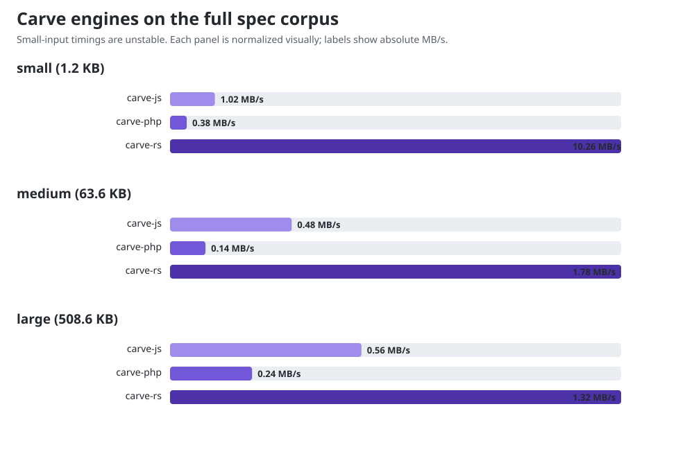
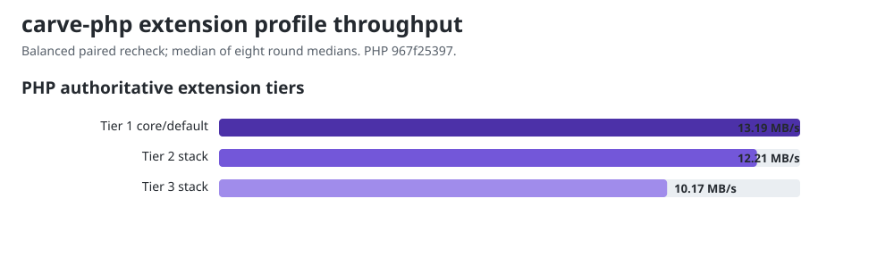

# Benchmark results: authoritative/full parser

This is **Track B**, the Carve-owned authoritative/full-parser view. The mixed
corpus falls outside the conservative borrowed facades and therefore exercises
normal AST construction, extension-capable parsing, and rendering. It answers
how the three Carve implementations scale on their full language, not how their
fastest core-only convenience API compares with another library.

For **Track A**, the primary core source-to-HTML comparison against the
same-language libraries, see [the current core report](reports/dev-main-core.md).

Parse + render to HTML, in-process, averaged over many iterations. Lower
ms/op and higher MB/s are better. `rel` is relative to the fastest engine for
that document (1.00x = fastest). Numbers are machine-specific - run it yourself
with `node run.mjs`; see README for setup.

**Run:** 2026-10-21T03:24:46.274Z; serial processes; Node v22.22.2; PHP 8.5.11 (cli) (built: Sep 24 2026 13:49:29) (NTS); rustc 1.97.1 (8bab26f4f 2026-07-14).

Allowed CPUs: 12. Child processes inherit this affinity, including Node compiler and GC threads.

One-minute host load was 21.29 at start and 10.64 at end. CPU affinity does not reserve a core; these shared-host samples do not isolate code speedups.

The `rel` column compares elapsed time. Check the
[output byte counts and hashes](reports/dev-main-full-output-controls.json)
before treating cross-engine results as equal work.

PHP output controls use a clean configuration without JIT, while these timings use tracing JIT.

**Engines measured:** carve-js `@markup-carve/carve 0.1.12 (local checkout carve-js-main @ 2ce388c28)`, carve-php `markup-carve/carve-php (local checkout carve-php-main @ 2a7a38145)`, carve-rs `carve-lang 0.1.10 (local checkout carve-rs-main @ 47fdd7e48)`

**Corpus snapshot:** Fixed committed corpus; input hashes are recorded in the full-run JSON.

## small (1.2 KB)

| Engine | ms/op | MB/s | rel |
|---|---:|---:|---:|
| carve-js | 2.1669 | 0.54 | 15.86x |
| carve-php | 2.9667 | 0.40 | 21.72x |
| carve-rs | 0.1366 | 8.61 | 1.00x |

## medium (63.6 KB)

| Engine | ms/op | MB/s | rel |
|---|---:|---:|---:|
| carve-js | 244.7102 | 0.25 | 3.90x |
| carve-php | 346.7912 | 0.18 | 5.52x |
| carve-rs | 62.7991 | 0.99 | 1.00x |

## large (508.6 KB)

| Engine | ms/op | MB/s | rel |
|---|---:|---:|---:|
| carve-js | 1696.6831 | 0.29 | 3.53x |
| carve-php | 2622.7445 | 0.19 | 5.45x |
| carve-rs | 481.0156 | 1.03 | 1.00x |

## PHP authoritative extension tiers

Current tier values use the [same-process alternating run](reports/php-tier-balanced.json) at PHP commit `2a7a38145ae88e8dce294b924e937537b4a69399`. Each value is the median of 15 rounds with 40 conversions per profile and round. These measurements are separate from the full-corpus rows above.

The [original unpaired tier observations](reports/php-tiers-unpaired-20261015.md) and full-run JSON remain unchanged as historical evidence. Tier 1 and Tier 2 render identical HTML on this input. Tier 3 changes output, so its timing includes that work. The three profiles share one JIT buffer and warm up in Tier 1, Tier 2, Tier 3 order before alternating measured rounds.

| Profile | Registered extensions | ms/op | MB/s | cost vs Tier 1 | round range, ms |
|---|---:|---:|---:|---:|---:|
| Tier 1 core/default | 0 | 6.53 | 7.19 | baseline | 3.77 to 7.53 |
| Tier 2 stack | 8 | 7.22 | 6.50 | +11% | 4.33 to 10.17 |
| Tier 3 stack | 20 | 8.55 | 5.49 | +31% | 5.29 to 13.92 |

The exact extension bundles and interpretation are documented in
[`FINDINGS.md`](./FINDINGS.md#extension-tier-cost). There is no normative Tier
3 profile; it is a reproducible internal stress stack.

## Why Track B has no competitor rows

The corpus uses Carve syntax and capabilities that peer libraries do not
accept equivalently. Feeding it to Djot/CommonMark parsers would benchmark
literal/error recovery rather than the same work. Track A therefore uses
equivalent native-language fixtures for competitors.

Worker results, source commits, input hashes and runtime settings are recorded
in [the full-run JSON](reports/dev-main-full.json).
