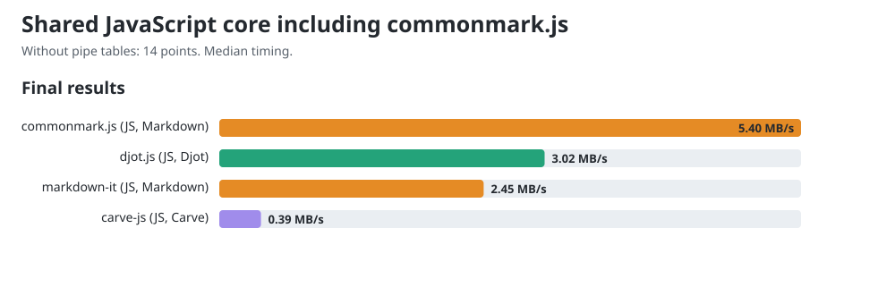

# JavaScript core comparison including commonmark.js

Allowed CPUs: 11. Child processes inherit this affinity, including Node compiler and GC threads. Measured 2026-11-12T12:15:21.328Z, Node v26.12.1, Intel(R) Core(TM) i7-10750H CPU @ 2.60GHz, 12 logical CPUs. Benchmark harness checkout: `144957afbf8cc84d57cabd4f7a047e62b838b4c2`; cached remote main: `5a7399456378d1b28a3fe06dd8e05aed878e427e`; dirty tracked tree: true. Harness hashes are recorded in the JSON.

Released packages: Carve JS 0.1.16, Djot 0.3.2, markdown-it 15.0.0, commonmark.js 0.31.2.

This shared workload excludes pipe tables, which commonmark.js does not support. All four libraries receive 150 equivalent sections in native syntax. The 14 exercised points are the existing 18-point rubric without its three table-grid points and one alignment point. These measurements form a separate lane from [the comparison with pipe tables](../COMPARISON.md); their throughput values must not be mixed.

Before timing, all engines agree under an HTML projection that ignores section wrappers, generated IDs, list paragraph wrappers and non-code whitespace formatting. It preserves element hierarchy, emphasis versus strong, resolved link destinations, code language and code bytes. This is scoped workload verification, not general language conformance.

## Final chart values

The charts and site show one final value per engine: throughput computed from median timing across all trial samples from both measurement rounds. The diagnostic round tables below show each round's fastest trial.

| Engine | Median ms/op | MB/s |
|---|---:|---:|
| carve-js | 122.5420 | 0.39 |
| djot.js | 15.7028 | 3.02 |
| markdown-it | 19.5521 | 2.45 |
| commonmark.js | 8.8868 | 5.40 |



## Reused public conversion APIs

| Engine | Bytes | Round 1 fastest MB/s | Round 2 fastest MB/s |
|---|---:|---:|---:|
| carve-js | 49732 | 0.42 | 0.45 |
| djot.js | 49732 | 3.40 | 3.69 |
| markdown-it | 50332 | 2.15 | 3.92 |
| commonmark.js | 50332 | 5.62 | 7.25 |

## CommonMark constructor control

| API lifetime | Round 1 fastest ms/op | Round 2 fastest ms/op |
|---|---:|---:|
| Reuse parser and renderer | 8.5339 | 6.6202 |
| Construct both per call | 5.3272 | 5.5502 |

The lifetime control investigates the parser-construction concern in [djot.js #13](https://github.com/jgm/djot.js/issues/13). markdown-it also reuses its instance; Carve and Djot use their public conversion functions. These are default API costs, not equal object lifetimes. The table records both lifetimes; it does not isolate constructor cost from runtime optimization.

One-minute host load was 27.63 at start and 8.46 at end. Timings are observations on this host; the reversed rounds retain order variation. No universal speed ranking is established.

## Reproduce

Use Node v26.12.1 for this snapshot.

```sh
cd engines/js
npm ci
cd ../..


node scripts/compare-commonmark.mjs
node scripts/gen-charts.mjs
```


The [raw record](commonmark-js-release-0.1.16.json) retains all trial samples, both rounds, source/output hashes, workload controls, exact package versions and harness hashes.
