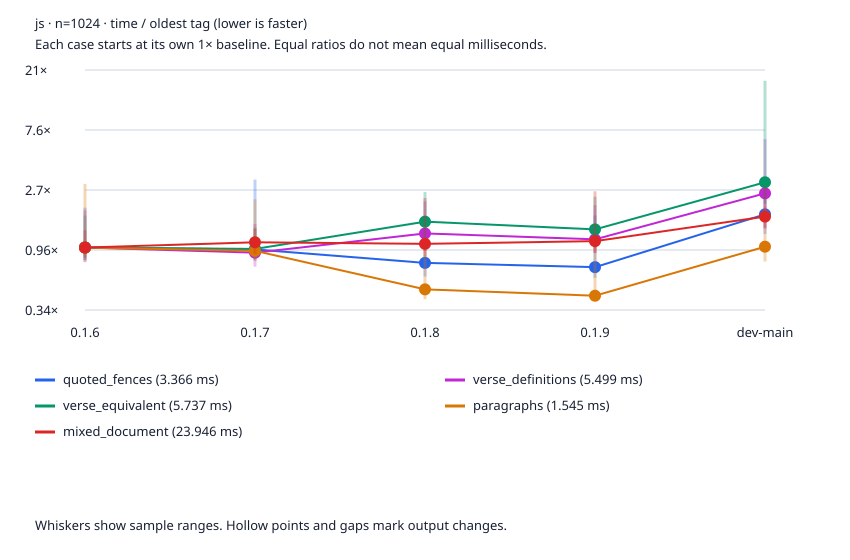
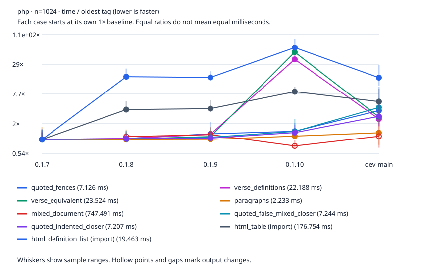

# Engine release history

Retained sessions began 2026-10-02T12:21:26.895588+00:00. 4 stable tags per engine plus a pinned dev-main when measured source differs from the newest tag.

Median elapsed milliseconds; lower is faster. Each revision uses the same fixtures; runtime versions are recorded for each engine and revision. Samples exclude process startup. Node warms each workload for at least 500 ms and a minimum iteration count. Rust uses an optimized release build; PHP has CLI opcache/JIT and coverage disabled. These settings differ from the headline benchmark, so compare revisions within this history rather than mixing report numbers.

The host is shared. CPU affinity does not reserve a core. Raw samples, minimum/maximum times, load averages, source fingerprints, runtime versions and worker hashes are in the JSON. A changed output hash means the timing is for different work. Each case has its own oldest-tag baseline of 1×; equal starting ratios do not mean equal milliseconds. The legend lists those baseline times. Graphs use a logarithmic time ratio and connect points only when their output hashes agree.

[Interactive history](engine-history.html) · [Raw JSON](engine-history.json) · [CSV](engine-history.csv)

## Measurement sessions

Release-tag measurements retain their original sessions. All three merged main points were refreshed 2026-10-20T12:14:40.794981+00:00 with the same fixtures, workers and sampling counts on CPU 13. Separate shared-host sessions and build configurations do not isolate code speedups.

js retained measurements: driver `70fe1de88f1b7e9705c65d831d2e3bcf4cc9d537`, session started 2026-10-02T12:21:26.895588+00:00, CPU affinity [12]; dirty benchmark tree: False.

php retained measurements: driver `70fe1de88f1b7e9705c65d831d2e3bcf4cc9d537`, session started 2026-10-02T12:21:26.895588+00:00, CPU affinity [12]; dirty benchmark tree: False.

rs retained measurements: driver `70fe1de88f1b7e9705c65d831d2e3bcf4cc9d537`, session started 2026-10-02T12:21:26.895588+00:00, CPU affinity [12]; dirty benchmark tree: False.

js dev-main refresh: 2026-10-20T12:09:57.585308+00:00 to 2026-10-20T12:10:31.112232+00:00; driver `25a4c19a9bd9ffe7eef232c34a26d534b5de8da7`, CPU affinity [13]; dirty benchmark tree: True. [Point provenance](engine-history.json).

php dev-main refresh: 2026-10-20T12:10:31.554177+00:00 to 2026-10-20T12:14:39.771482+00:00; driver `25a4c19a9bd9ffe7eef232c34a26d534b5de8da7`, CPU affinity [13]; dirty benchmark tree: True. [Point provenance](engine-history.json).

rs dev-main refresh: 2026-10-20T12:14:39.796660+00:00 to 2026-10-20T12:14:40.771618+00:00; driver `25a4c19a9bd9ffe7eef232c34a26d534b5de8da7`, CPU affinity [13]; dirty benchmark tree: True. [Point provenance](engine-history.json).

## Shared-host spread

Retained session initial load average: [5.18994140625, 5.53466796875, 5.52490234375]. Final load average: [7.6640625, 8.294921875, 7.34130859375]. Whiskers show sample ranges; medians from noisy sessions are descriptive readings, not confirmed speed changes.

js dev-main refresh load average: initial [7.30908203125, 17.38232421875, 23.75]; final [9.56298828125, 16.8330078125, 23.3291015625].

php dev-main refresh load average: initial [9.56298828125, 16.8330078125, 23.3291015625]; final [17.001953125, 17.40283203125, 21.98291015625].

rs dev-main refresh load average: initial [17.001953125, 17.40283203125, 21.98291015625]; final [17.001953125, 17.40283203125, 21.98291015625].

js: widest sample range is 12.9x for 0.1.8 verse_equivalent n=128 (0.748 to 9.631 ms). Inspect round medians in the JSON before attributing a difference to code.

php: widest sample range is 21.8x for dev-main html_definition_list n=128 (18.254 to 398.544 ms). Inspect round medians in the JSON before attributing a difference to code.

rs: widest sample range is 7.2x for 0.1.6 verse_equivalent n=128 (0.115 to 0.829 ms). Inspect round medians in the JSON before attributing a difference to code.

## Watchpoints

- php dev-main quoted_fences n=128: 2.660 ms versus 0.949 ms on 0.1.7 (+180.3%). Output hashes match and sample ranges are separate; a paired run is needed to attribute the difference.
- php dev-main quoted_fences n=128: 2.660 ms versus 1.255 ms on 0.1.10 (+112.0%). Output hashes match and sample ranges are separate; a paired run is needed to attribute the difference.
- php dev-main quoted_false_mixed_closer n=128: 2.243 ms versus 1.051 ms on 0.1.8 (+113.5%). Output hashes match and sample ranges are separate; a paired run is needed to attribute the difference.
- php dev-main quoted_indented_closer n=128: 2.836 ms versus 0.967 ms on 0.1.7 (+193.3%). Output hashes match and sample ranges are separate; a paired run is needed to attribute the difference.
- php dev-main quoted_indented_closer n=128: 2.836 ms versus 1.040 ms on 0.1.8 (+172.8%). Output hashes match and sample ranges are separate; a paired run is needed to attribute the difference.
- php dev-main quoted_indented_closer n=128: 2.836 ms versus 1.294 ms on 0.1.10 (+119.2%). Output hashes match and sample ranges are separate; a paired run is needed to attribute the difference.
- php dev-main html_table n=128: 84.977 ms versus 23.403 ms on 0.1.7 (+263.1%). Output hashes match and sample ranges are separate; a paired run is needed to attribute the difference.
- php dev-main html_definition_list n=128: 27.303 ms versus 2.418 ms on 0.1.7 (+1029.0%). Output hashes match and sample ranges are separate; a paired run is needed to attribute the difference.
- php dev-main quoted_fences n=1024: 17.030 ms versus 7.126 ms on 0.1.7 (+139.0%). Output hashes match and sample ranges are separate; a paired run is needed to attribute the difference.
- php dev-main quoted_fences n=1024: 17.030 ms versus 7.411 ms on 0.1.8 (+129.8%). Output hashes match and sample ranges are separate; a paired run is needed to attribute the difference.
- php dev-main verse_definitions n=1024: 47.988 ms versus 22.188 ms on 0.1.7 (+116.3%). Output hashes match and sample ranges are separate; a paired run is needed to attribute the difference.
- php dev-main verse_definitions n=1024: 47.988 ms versus 23.174 ms on 0.1.8 (+107.1%). Output hashes match and sample ranges are separate; a paired run is needed to attribute the difference.
- php dev-main verse_equivalent n=1024: 48.529 ms versus 23.524 ms on 0.1.7 (+106.3%). Output hashes match and sample ranges are separate; a paired run is needed to attribute the difference.
- php dev-main verse_equivalent n=1024: 48.529 ms versus 23.905 ms on 0.1.8 (+103.0%). Output hashes match and sample ranges are separate; a paired run is needed to attribute the difference.
- php dev-main quoted_false_mixed_closer n=1024: 16.427 ms versus 7.244 ms on 0.1.7 (+126.8%). Output hashes match and sample ranges are separate; a paired run is needed to attribute the difference.
- php dev-main quoted_false_mixed_closer n=1024: 16.427 ms versus 7.386 ms on 0.1.8 (+122.4%). Output hashes match and sample ranges are separate; a paired run is needed to attribute the difference.
- php dev-main quoted_false_mixed_closer n=1024: 16.427 ms versus 7.992 ms on 0.1.9 (+105.5%). Output hashes match and sample ranges are separate; a paired run is needed to attribute the difference.
- php dev-main quoted_indented_closer n=1024: 18.399 ms versus 7.207 ms on 0.1.7 (+155.3%). Output hashes match and sample ranges are separate; a paired run is needed to attribute the difference.
- php dev-main quoted_indented_closer n=1024: 18.399 ms versus 7.389 ms on 0.1.8 (+149.0%). Output hashes match and sample ranges are separate; a paired run is needed to attribute the difference.
- php dev-main quoted_indented_closer n=1024: 18.399 ms versus 7.642 ms on 0.1.9 (+140.8%). Output hashes match and sample ranges are separate; a paired run is needed to attribute the difference.
- php dev-main html_table n=1024: 855.043 ms versus 176.754 ms on 0.1.7 (+383.7%). Output hashes match and sample ranges are separate; a paired run is needed to attribute the difference.
- php dev-main html_definition_list n=1024: 322.696 ms versus 19.463 ms on 0.1.7 (+1558.0%). Output hashes match and sample ranges are separate; a paired run is needed to attribute the difference.

## Uncertain +100% readings

- php dev-main quoted_fences n=128: 2.660 ms versus 0.986 ms on 0.1.8 (+169.8%). Sample ranges overlap; this session does not establish a +100% regression.
- php dev-main verse_equivalent n=128: 6.135 ms versus 2.995 ms on 0.1.7 (+104.9%). Sample ranges overlap; this session does not establish a +100% regression.
- php dev-main quoted_indented_closer n=128: 2.836 ms versus 1.367 ms on 0.1.9 (+107.4%). Sample ranges overlap; this session does not establish a +100% regression.

## js

Runtime: v22.22.2. Latest tag: 0.1.9.

| Revision | Commit |
|---|---|
| 0.1.6 | `379474fbc87a9afe36620e2b71902f88d2b757b5` |
| 0.1.7 | `680af386605367bb86a07c2b258673c6514c4005` |
| 0.1.8 | `23204e8982012a4b3900dc735e46b3c2630803c2` |
| 0.1.9 | `a0cb0ad18fc4da223e46cfb77672e4dec537a83b` |
| dev-main | `ccbbdcc983b01ffb9a53e4293bd63d0540325643` |

Merged main refreshed 2026-10-20T12:10:31.112282+00:00; release samples retained. Cross-session differences do not establish code speedups.

| Point | Case | n | Latest tag ms | Point ms | vs tag | Main ms | vs main | Same output as tag | Tag range ms | Point range ms |
|---|---|---:|---:|---:|---:|---:|---:|:---:|---:|---:|
| dev-main | quoted_fences | 128 | 0.311 | 0.501 | ranges overlap | 0.501 | +0.0% | yes | 0.254 to 1.718 | 0.269 to 1.341 |
| dev-main | verse_definitions | 128 | 0.744 | 0.940 | ranges overlap | 0.940 | +0.0% | yes | 0.656 to 2.999 | 0.773 to 4.737 |
| dev-main | verse_equivalent | 128 | 0.850 | 1.075 | ranges overlap | 1.075 | +0.0% | yes | 0.686 to 1.712 | 0.856 to 4.376 |
| dev-main | paragraphs | 128 | 0.079 | 0.087 | ranges overlap | 0.087 | +0.0% | yes | 0.075 to 0.101 | 0.072 to 0.197 |
| dev-main | mixed_document | 128 | 1.451 | 1.683 | ranges overlap | 1.683 | +0.0% | yes | 1.217 to 2.254 | 1.350 to 3.169 |
| dev-main | quoted_fences | 1024 | 2.401 | 2.554 | ranges overlap | 2.554 | +0.0% | yes | 1.997 to 5.849 | 2.127 to 5.121 |
| dev-main | verse_definitions | 1024 | 6.334 | 7.384 | ranges overlap | 7.384 | +0.0% | yes | 5.014 to 11.435 | 5.477 to 23.847 |
| dev-main | verse_equivalent | 1024 | 7.843 | 8.304 | ranges overlap | 8.304 | +0.0% | yes | 5.643 to 13.768 | 6.368 to 17.095 |
| dev-main | paragraphs | 1024 | 0.673 | 0.682 | ranges overlap | 0.682 | +0.0% | yes | 0.634 to 1.763 | 0.612 to 2.244 |
| dev-main | mixed_document | 1024 | 26.744 | 23.023 | ranges overlap | 23.023 | +0.0% | yes | 21.797 to 63.089 | 17.871 to 32.744 |

## php

Runtime: 8.5.11. Latest tag: 0.1.10.

| Revision | Commit |
|---|---|
| 0.1.7 | `9fd773b229d4d63b8b468b87b122943d563c80dc` |
| 0.1.8 | `93409af08040344221ff0d2d2d40351c8105e413` |
| 0.1.9 | `d4b53388df891158c9c868177a4213a5e8b2f608` |
| 0.1.10 | `6d94607eaa9d51c9ed782342161beca77b05aaf9` |
| dev-main | `8752b183da661c5fec5296657b56ddb7025a0f4c` |

Merged main refreshed 2026-10-20T12:14:39.771512+00:00; release samples retained. Cross-session differences do not establish code speedups.

| Point | Case | n | Latest tag ms | Point ms | vs tag | Main ms | vs main | Same output as tag | Tag range ms | Point range ms |
|---|---|---:|---:|---:|---:|---:|---:|:---:|---:|---:|
| dev-main | quoted_fences | 128 | 1.255 | 2.660 | +112.0% | 2.660 | +0.0% | yes | 1.187 to 1.458 | 1.987 to 28.416 |
| dev-main | verse_definitions | 128 | 17.196 | 5.474 | ranges overlap | 5.474 | +0.0% | yes | 15.922 to 19.451 | 4.175 to 44.425 |
| dev-main | verse_equivalent | 128 | 24.120 | 6.135 | ranges overlap | 6.135 | +0.0% | yes | 21.500 to 32.741 | 4.392 to 62.292 |
| dev-main | paragraphs | 128 | 0.337 | 0.255 | ranges overlap | 0.255 | +0.0% | yes | 0.314 to 0.538 | 0.195 to 1.803 |
| dev-main | mixed_document | 128 | 4.114 | 3.935 | ranges overlap | 3.935 | +0.0% | yes | 3.662 to 6.599 | 2.731 to 40.301 |
| dev-main | quoted_false_mixed_closer | 128 | 1.303 | 2.243 | ranges overlap | 2.243 | +0.0% | yes | 1.208 to 2.339 | 1.630 to 34.677 |
| dev-main | quoted_indented_closer | 128 | 1.294 | 2.836 | +119.2% | 2.836 | +0.0% | yes | 1.190 to 2.059 | 2.130 to 37.233 |
| dev-main | html_table | 128 | 86.981 | 84.977 | ranges overlap | 84.977 | +0.0% | yes | 74.461 to 143.771 | 61.562 to 821.303 |
| dev-main | html_definition_list | 128 | 44.049 | 27.303 | ranges overlap | 27.303 | +0.0% | yes | 39.431 to 76.770 | 18.254 to 398.544 |
| dev-main | quoted_fences | 1024 | 10.285 | 17.030 | ranges overlap | 17.030 | +0.0% | yes | 8.763 to 15.076 | 11.509 to 83.872 |
| dev-main | verse_definitions | 1024 | 800.499 | 47.988 | -94.0% | 47.988 | +0.0% | yes | 721.439 to 981.896 | 36.701 to 426.104 |
| dev-main | verse_equivalent | 1024 | 1174.312 | 48.529 | -95.9% | 48.529 | +0.0% | yes | 1069.473 to 1300.351 | 35.529 to 350.204 |
| dev-main | paragraphs | 1024 | 2.593 | 1.888 | ranges overlap | 1.888 | +0.0% | yes | 2.510 to 3.375 | 1.628 to 11.135 |
| dev-main | mixed_document | 1024 | 557.954 | 686.946 | ranges overlap | 686.946 | +0.0% | yes | 481.274 to 719.898 | 585.985 to 3517.249 |
| dev-main | quoted_false_mixed_closer | 1024 | 10.379 | 16.427 | ranges overlap | 16.427 | +0.0% | yes | 8.490 to 18.159 | 12.674 to 97.446 |
| dev-main | quoted_indented_closer | 1024 | 9.795 | 18.399 | +87.8% | 18.399 | +0.0% | yes | 8.413 to 13.812 | 15.213 to 153.827 |
| dev-main | html_table | 1024 | 1499.097 | 855.043 | ranges overlap | 855.043 | +0.0% | yes | 1315.302 to 1868.470 | 752.290 to 3422.547 |
| dev-main | html_definition_list | 1024 | 1190.962 | 322.696 | ranges overlap | 322.696 | +0.0% | yes | 1064.362 to 1774.015 | 281.714 to 2211.377 |

## rs

Runtime: rustc 1.97.1 (8bab26f4f 2026-07-14). Latest tag: 0.1.7.

| Revision | Commit |
|---|---|
| 0.1.4 | `2e9c43f22c5ed05dbd93323ae6b9c94bb867b285` |
| 0.1.5 | `56cb353657375e1a85965d5fcf00a234831d82c6` |
| 0.1.6 | `d7837249c64b88879b04cd71b8b5555ff246e16f` |
| 0.1.7 | `9f3f334c7d5c91c57e4e6269b32599af1062fdde` |
| dev-main | `f95434c91c0faca54fb221281b82e999ecb7cf3c` |

Rust main and retained tags record different Cargo configuration fingerprints or build recipes. Their timings do not isolate engine speed changes; compare build_configuration for each revision.

Merged main refreshed 2026-10-20T12:14:40.771652+00:00; release samples retained. Cross-session differences do not establish code speedups.

| Point | Case | n | Latest tag ms | Point ms | vs tag | Main ms | vs main | Same output as tag | Tag range ms | Point range ms |
|---|---|---:|---:|---:|---:|---:|---:|:---:|---:|---:|
| dev-main | quoted_fences | 128 | 0.101 | 0.056 | ranges overlap | 0.056 | +0.0% | yes | 0.099 to 0.125 | 0.053 to 0.099 |
| dev-main | verse_definitions | 128 | 0.184 | 0.220 | n/a: different output | 0.220 | +0.0% | no | 0.176 to 0.231 | 0.191 to 0.364 |
| dev-main | verse_equivalent | 128 | 0.197 | 0.157 | ranges overlap | 0.157 | +0.0% | yes | 0.181 to 0.311 | 0.138 to 0.230 |
| dev-main | paragraphs | 128 | 0.028 | 0.023 | ranges overlap | 0.023 | +0.0% | yes | 0.026 to 0.044 | 0.022 to 0.043 |
| dev-main | mixed_document | 128 | 0.389 | 0.244 | ranges overlap | 0.244 | +0.0% | yes | 0.296 to 0.504 | 0.226 to 0.497 |
| dev-main | quoted_fences | 1024 | 2.208 | 0.433 | -80.4% | 0.433 | +0.0% | yes | 2.070 to 2.663 | 0.393 to 0.719 |
| dev-main | verse_definitions | 1024 | 1.821 | 1.616 | n/a: different output | 1.616 | +0.0% | no | 1.730 to 3.594 | 1.437 to 2.530 |
| dev-main | verse_equivalent | 1024 | 1.788 | 1.186 | ranges overlap | 1.186 | +0.0% | yes | 1.354 to 3.493 | 1.085 to 1.804 |
| dev-main | paragraphs | 1024 | 0.218 | 0.194 | ranges overlap | 0.194 | +0.0% | yes | 0.199 to 0.391 | 0.173 to 0.326 |
| dev-main | mixed_document | 1024 | 2.649 | 2.011 | ranges overlap | 2.011 | +0.0% | yes | 2.552 to 4.102 | 1.815 to 4.051 |

