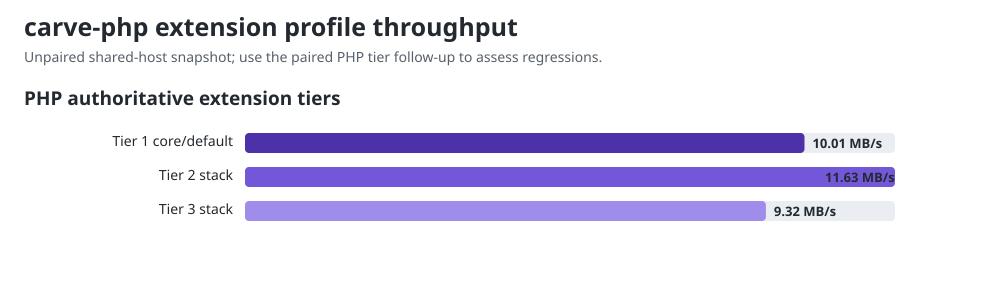

# Historical unpaired PHP tier observations

These observations are retained from the original October 15 full run. The [raw full-run record](dev-main-full.json) retains the samples and measurement method. Current tier displays use the paired recheck.

## PHP authoritative extension tiers

The apparent Tier 1 increase in this unpaired run is rechecked in the [paired PHP tier report](php-tier-pairs.md). Its alternating measurements retain both elapsed and process CPU time. This table preserves the original observations; it does not establish a PHP regression.

These are internal Carve measurements over the same core document, measured
by this run rather than transcribed. Tier 1 is the default public conversion
route; Tier 2 and Tier 3 register opt-in extensions on top of it. Since
carve-php #1515 made configured conversion allocation-light, registering an
extension no longer forces a wholly separate slow path, so these rows read as
registration and hook costs on a document whose content does not trigger
the registered extensions. Shared host noise can affect ratios, including
apparent negative overhead. These are internal diagnostics, not competitor rows.

| Profile | Registered extensions | ms/op | MB/s | cost vs Tier 1 |
|---|---:|---:|---:|---:|
| Tier 1 core/default | 0 | 4.69 | 10.01 | baseline |
| Tier 2 stack | 8 | 4.04 | 11.63 | -14% |
| Tier 3 stack | 20 | 5.04 | 9.32 | +7% |

The exact extension bundles and interpretation are documented in
[`FINDINGS.md`](../FINDINGS.md#extension-tier-cost). There is no normative Tier
3 profile; it is a reproducible internal stress stack.
