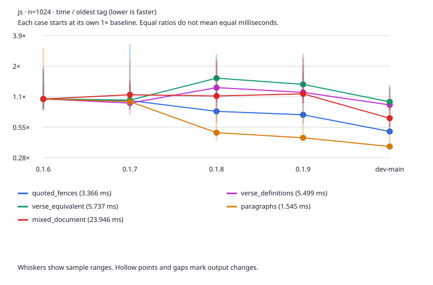
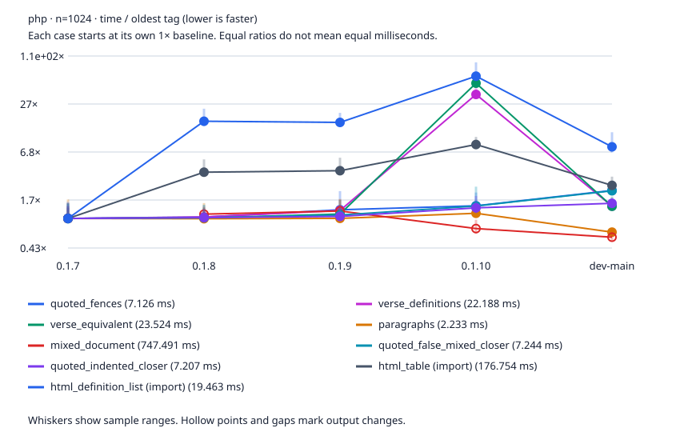
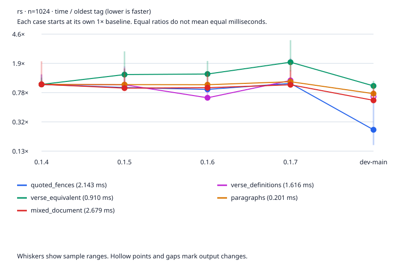

# Engine release history

Retained sessions began 2026-10-02T12:21:26.895588+00:00. 4 stable tags per engine plus a pinned dev-main when measured source differs from the newest tag.

Median elapsed milliseconds; lower is faster. Each revision uses the same fixtures; runtime versions are recorded for each engine and revision. Samples exclude process startup. Node warms each workload for at least 500 ms and a minimum iteration count. Rust uses an optimized release build; PHP has CLI opcache/JIT and coverage disabled. These settings differ from the headline benchmark, so compare revisions within this history rather than mixing report numbers.

The host is shared. CPU affinity does not reserve a core. Raw samples, minimum/maximum times, load averages, source fingerprints, runtime versions and worker hashes are in the JSON. A changed output hash means the timing is for different work. Each case has its own oldest-tag baseline of 1×; equal starting ratios do not mean equal milliseconds. The legend lists those baseline times. Graphs use a logarithmic time ratio and connect points only when their output hashes agree.

[Interactive history](engine-history.html) · [Raw JSON](engine-history.json) · [CSV](engine-history.csv)

## Measurement sessions

Release-tag measurements retain their original sessions. All three merged main points were refreshed 2026-10-14T10:36:02.718716+00:00 with the same fixtures, workers and sampling counts on CPU 13. Separate shared-host sessions and build configurations do not isolate code speedups.

js retained measurements: driver `70fe1de88f1b7e9705c65d831d2e3bcf4cc9d537`, session started 2026-10-02T12:21:26.895588+00:00, CPU affinity [12]; dirty benchmark tree: False.

php retained measurements: driver `70fe1de88f1b7e9705c65d831d2e3bcf4cc9d537`, session started 2026-10-02T12:21:26.895588+00:00, CPU affinity [12]; dirty benchmark tree: False.

rs retained measurements: driver `70fe1de88f1b7e9705c65d831d2e3bcf4cc9d537`, session started 2026-10-02T12:21:26.895588+00:00, CPU affinity [12]; dirty benchmark tree: False.

js dev-main refresh: 2026-10-14T10:34:09.299984+00:00 to 2026-10-14T10:34:36.223700+00:00; driver `fad0676e00c91c6224bc1b792297ecdeb12a8a84`, CPU affinity [13]; dirty benchmark tree: True. [Point provenance](engine-history.json).

php dev-main refresh: 2026-10-14T10:34:36.633010+00:00 to 2026-10-14T10:36:01.984972+00:00; driver `fad0676e00c91c6224bc1b792297ecdeb12a8a84`, CPU affinity [13]; dirty benchmark tree: True. [Point provenance](engine-history.json).

rs dev-main refresh: 2026-10-14T10:36:02.001112+00:00 to 2026-10-14T10:36:02.703498+00:00; driver `fad0676e00c91c6224bc1b792297ecdeb12a8a84`, CPU affinity [13]; dirty benchmark tree: True. [Point provenance](engine-history.json).

## Shared-host spread

Retained session initial load average: [5.18994140625, 5.53466796875, 5.52490234375]. Final load average: [7.6640625, 8.294921875, 7.34130859375]. Whiskers show sample ranges; medians from noisy sessions are descriptive readings, not confirmed speed changes.

js dev-main refresh load average: initial [4.63330078125, 7.29638671875, 8.15625]; final [4.19384765625, 6.98095703125, 8.02880859375].

php dev-main refresh load average: initial [4.19384765625, 6.98095703125, 8.02880859375]; final [3.20263671875, 6.04541015625, 7.609375].

rs dev-main refresh load average: initial [3.20263671875, 6.04541015625, 7.609375]; final [3.20263671875, 6.04541015625, 7.609375].

js: widest sample range is 12.9x for 0.1.8 verse_equivalent n=128 (0.748 to 9.631 ms). Inspect round medians in the JSON before attributing a difference to code.

php: widest sample range is 5.5x for 0.1.9 paragraphs n=128 (0.274 to 1.495 ms). Inspect round medians in the JSON before attributing a difference to code.

rs: widest sample range is 7.2x for 0.1.6 verse_equivalent n=128 (0.115 to 0.829 ms). Inspect round medians in the JSON before attributing a difference to code.

## Watchpoints

- php dev-main quoted_fences n=128: 2.109 ms versus 0.949 ms on 0.1.7 (+122.2%). Output hashes match and sample ranges are separate; a paired run is needed to attribute the difference.
- php dev-main html_table n=128: 47.965 ms versus 23.403 ms on 0.1.7 (+104.9%). Output hashes match and sample ranges are separate; a paired run is needed to attribute the difference.
- php dev-main html_definition_list n=128: 16.455 ms versus 2.418 ms on 0.1.7 (+580.5%). Output hashes match and sample ranges are separate; a paired run is needed to attribute the difference.
- php dev-main quoted_fences n=1024: 16.027 ms versus 7.126 ms on 0.1.7 (+124.9%). Output hashes match and sample ranges are separate; a paired run is needed to attribute the difference.
- php dev-main quoted_fences n=1024: 16.027 ms versus 7.411 ms on 0.1.8 (+116.3%). Output hashes match and sample ranges are separate; a paired run is needed to attribute the difference.
- php dev-main quoted_false_mixed_closer n=1024: 16.115 ms versus 7.244 ms on 0.1.7 (+122.5%). Output hashes match and sample ranges are separate; a paired run is needed to attribute the difference.
- php dev-main quoted_false_mixed_closer n=1024: 16.115 ms versus 7.386 ms on 0.1.8 (+118.2%). Output hashes match and sample ranges are separate; a paired run is needed to attribute the difference.
- php dev-main quoted_false_mixed_closer n=1024: 16.115 ms versus 7.992 ms on 0.1.9 (+101.6%). Output hashes match and sample ranges are separate; a paired run is needed to attribute the difference.
- php dev-main html_table n=1024: 460.000 ms versus 176.754 ms on 0.1.7 (+160.2%). Output hashes match and sample ranges are separate; a paired run is needed to attribute the difference.
- php dev-main html_definition_list n=1024: 154.355 ms versus 19.463 ms on 0.1.7 (+693.1%). Output hashes match and sample ranges are separate; a paired run is needed to attribute the difference.

## Uncertain +100% readings

- php dev-main quoted_fences n=128: 2.109 ms versus 0.986 ms on 0.1.8 (+113.9%). Sample ranges overlap; this session does not establish a +100% regression.

## js

Runtime: v22.22.2. Latest tag: 0.1.9.

| Revision | Commit |
|---|---|
| 0.1.6 | `379474fbc87a9afe36620e2b71902f88d2b757b5` |
| 0.1.7 | `680af386605367bb86a07c2b258673c6514c4005` |
| 0.1.8 | `23204e8982012a4b3900dc735e46b3c2630803c2` |
| 0.1.9 | `a0cb0ad18fc4da223e46cfb77672e4dec537a83b` |
| dev-main | `43c888310a8b1f96b77e0a79672e96d6cfbe1b86` |

Merged main refreshed 2026-10-14T10:34:36.223720+00:00; release samples retained. Cross-session differences do not establish code speedups.

| Point | Case | n | Latest tag ms | Point ms | vs tag | Main ms | vs main | Same output as tag | Tag range ms | Point range ms |
|---|---|---:|---:|---:|---:|---:|---:|:---:|---:|---:|
| dev-main | quoted_fences | 128 | 0.311 | 0.249 | ranges overlap | 0.249 | +0.0% | yes | 0.254 to 1.718 | 0.218 to 2.386 |
| dev-main | verse_definitions | 128 | 0.744 | 0.659 | ranges overlap | 0.659 | +0.0% | yes | 0.656 to 2.999 | 0.591 to 3.636 |
| dev-main | verse_equivalent | 128 | 0.850 | 0.662 | ranges overlap | 0.662 | +0.0% | yes | 0.686 to 1.712 | 0.629 to 3.735 |
| dev-main | paragraphs | 128 | 0.079 | 0.069 | ranges overlap | 0.069 | +0.0% | yes | 0.075 to 0.101 | 0.063 to 0.135 |
| dev-main | mixed_document | 128 | 1.451 | 1.100 | ranges overlap | 1.100 | +0.0% | yes | 1.217 to 2.254 | 1.038 to 2.549 |
| dev-main | quoted_fences | 1024 | 2.401 | 1.680 | ranges overlap | 1.680 | +0.0% | yes | 1.997 to 5.849 | 1.591 to 2.834 |
| dev-main | verse_definitions | 1024 | 6.334 | 4.846 | ranges overlap | 4.846 | +0.0% | yes | 5.014 to 11.435 | 4.272 to 6.891 |
| dev-main | verse_equivalent | 1024 | 7.843 | 5.400 | ranges overlap | 5.400 | +0.0% | yes | 5.643 to 13.768 | 4.680 to 7.793 |
| dev-main | paragraphs | 1024 | 0.673 | 0.559 | ranges overlap | 0.559 | +0.0% | yes | 0.634 to 1.763 | 0.528 to 1.998 |
| dev-main | mixed_document | 1024 | 26.744 | 15.862 | -40.7% | 15.862 | +0.0% | yes | 21.797 to 63.089 | 13.302 to 19.863 |

## php

Runtime: 8.5.11. Latest tag: 0.1.10.

| Revision | Commit |
|---|---|
| 0.1.7 | `9fd773b229d4d63b8b468b87b122943d563c80dc` |
| 0.1.8 | `93409af08040344221ff0d2d2d40351c8105e413` |
| 0.1.9 | `d4b53388df891158c9c868177a4213a5e8b2f608` |
| 0.1.10 | `6d94607eaa9d51c9ed782342161beca77b05aaf9` |
| dev-main | `cb3dec89cba4bfeb7ea15861c952073ec4825567` |

Merged main refreshed 2026-10-14T10:36:01.984992+00:00; release samples retained. Cross-session differences do not establish code speedups.

| Point | Case | n | Latest tag ms | Point ms | vs tag | Main ms | vs main | Same output as tag | Tag range ms | Point range ms |
|---|---|---:|---:|---:|---:|---:|---:|:---:|---:|---:|
| dev-main | quoted_fences | 128 | 1.255 | 2.109 | +68.0% | 2.109 | +0.0% | yes | 1.187 to 1.458 | 1.996 to 3.798 |
| dev-main | verse_definitions | 128 | 17.196 | 3.787 | -78.0% | 3.787 | +0.0% | yes | 15.922 to 19.451 | 3.637 to 5.468 |
| dev-main | verse_equivalent | 128 | 24.120 | 4.059 | -83.2% | 4.059 | +0.0% | yes | 21.500 to 32.741 | 3.868 to 5.713 |
| dev-main | paragraphs | 128 | 0.337 | 0.192 | -42.9% | 0.192 | +0.0% | yes | 0.314 to 0.538 | 0.187 to 0.211 |
| dev-main | mixed_document | 128 | 4.114 | 2.575 | ranges overlap | 2.575 | +0.0% | yes | 3.662 to 6.599 | 2.472 to 4.048 |
| dev-main | quoted_false_mixed_closer | 128 | 1.303 | 2.093 | ranges overlap | 2.093 | +0.0% | yes | 1.208 to 2.339 | 2.011 to 3.607 |
| dev-main | quoted_indented_closer | 128 | 1.294 | 1.515 | ranges overlap | 1.515 | +0.0% | yes | 1.190 to 2.059 | 1.387 to 2.110 |
| dev-main | html_table | 128 | 86.981 | 47.965 | -44.9% | 47.965 | +0.0% | yes | 74.461 to 143.771 | 42.870 to 68.357 |
| dev-main | html_definition_list | 128 | 44.049 | 16.455 | -62.6% | 16.455 | +0.0% | yes | 39.431 to 76.770 | 13.813 to 22.081 |
| dev-main | quoted_fences | 1024 | 10.285 | 16.027 | +55.8% | 16.027 | +0.0% | yes | 8.763 to 15.076 | 15.131 to 18.711 |
| dev-main | verse_definitions | 1024 | 800.499 | 31.712 | -96.0% | 31.712 | +0.0% | yes | 721.439 to 981.896 | 29.106 to 36.475 |
| dev-main | verse_equivalent | 1024 | 1174.312 | 33.454 | -97.2% | 33.454 | +0.0% | yes | 1069.473 to 1300.351 | 29.906 to 44.426 |
| dev-main | paragraphs | 1024 | 2.593 | 1.504 | -42.0% | 1.504 | +0.0% | yes | 2.510 to 3.375 | 1.433 to 1.572 |
| dev-main | mixed_document | 1024 | 557.954 | 434.768 | ranges overlap | 434.768 | +0.0% | yes | 481.274 to 719.898 | 382.544 to 505.937 |
| dev-main | quoted_false_mixed_closer | 1024 | 10.379 | 16.115 | ranges overlap | 16.115 | +0.0% | yes | 8.490 to 18.159 | 15.276 to 18.650 |
| dev-main | quoted_indented_closer | 1024 | 9.795 | 11.163 | ranges overlap | 11.163 | +0.0% | yes | 8.413 to 13.812 | 10.493 to 13.127 |
| dev-main | html_table | 1024 | 1499.097 | 460.000 | -69.3% | 460.000 | +0.0% | yes | 1315.302 to 1868.470 | 418.055 to 592.016 |
| dev-main | html_definition_list | 1024 | 1190.962 | 154.355 | -87.0% | 154.355 | +0.0% | yes | 1064.362 to 1774.015 | 131.215 to 235.367 |

## rs

Runtime: rustc 1.97.1 (8bab26f4f 2026-07-14). Latest tag: 0.1.7.

| Revision | Commit |
|---|---|
| 0.1.4 | `2e9c43f22c5ed05dbd93323ae6b9c94bb867b285` |
| 0.1.5 | `56cb353657375e1a85965d5fcf00a234831d82c6` |
| 0.1.6 | `d7837249c64b88879b04cd71b8b5555ff246e16f` |
| 0.1.7 | `9f3f334c7d5c91c57e4e6269b32599af1062fdde` |
| dev-main | `61b673ce9d8c5628f4d4e3882d1fcb19f6002b2d` |

Rust main and retained tags record different Cargo configuration fingerprints or build recipes. Their timings do not isolate engine speed changes; compare build_configuration for each revision.

Merged main refreshed 2026-10-14T10:36:02.703529+00:00; release samples retained. Cross-session differences do not establish code speedups.

| Point | Case | n | Latest tag ms | Point ms | vs tag | Main ms | vs main | Same output as tag | Tag range ms | Point range ms |
|---|---|---:|---:|---:|---:|---:|---:|:---:|---:|---:|
| dev-main | quoted_fences | 128 | 0.101 | 0.047 | -53.0% | 0.047 | +0.0% | yes | 0.099 to 0.125 | 0.046 to 0.064 |
| dev-main | verse_definitions | 128 | 0.184 | 0.157 | n/a: different output | 0.157 | +0.0% | no | 0.176 to 0.231 | 0.150 to 0.225 |
| dev-main | verse_equivalent | 128 | 0.197 | 0.133 | ranges overlap | 0.133 | +0.0% | yes | 0.181 to 0.311 | 0.110 to 0.238 |
| dev-main | paragraphs | 128 | 0.028 | 0.019 | ranges overlap | 0.019 | +0.0% | yes | 0.026 to 0.044 | 0.019 to 0.035 |
| dev-main | mixed_document | 128 | 0.389 | 0.197 | -49.3% | 0.197 | +0.0% | yes | 0.296 to 0.504 | 0.193 to 0.233 |
| dev-main | quoted_fences | 1024 | 2.208 | 0.539 | -75.6% | 0.539 | +0.0% | yes | 2.070 to 2.663 | 0.338 to 1.951 |
| dev-main | verse_definitions | 1024 | 1.821 | 1.115 | n/a: different output | 1.115 | +0.0% | no | 1.730 to 3.594 | 1.083 to 1.340 |
| dev-main | verse_equivalent | 1024 | 1.788 | 0.869 | -51.4% | 0.869 | +0.0% | yes | 1.354 to 3.493 | 0.833 to 1.013 |
| dev-main | paragraphs | 1024 | 0.218 | 0.151 | ranges overlap | 0.151 | +0.0% | yes | 0.199 to 0.391 | 0.148 to 0.200 |
| dev-main | mixed_document | 1024 | 2.649 | 1.650 | -37.7% | 1.650 | +0.0% | yes | 2.552 to 4.102 | 1.596 to 2.379 |
