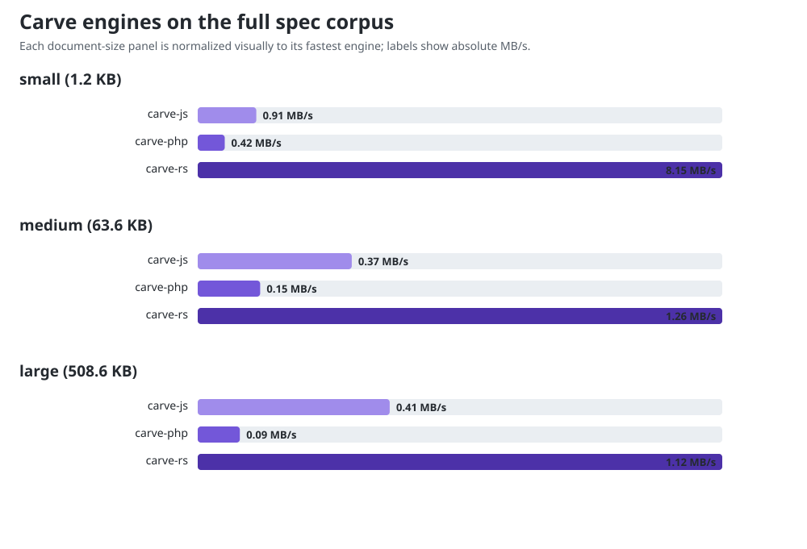
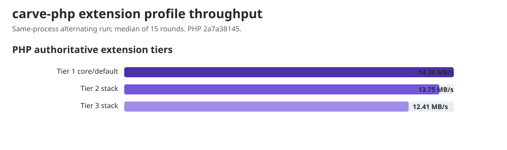

# Benchmark results: authoritative/full parser

This is **Track B**, the Carve-owned authoritative/full-parser view. The mixed
corpus falls outside the conservative borrowed facades and therefore exercises
normal AST construction, extension-capable parsing, and rendering. It answers
how the three Carve implementations scale on their full language, not how their
fastest core-only convenience API compares with another library.

For **Track A**, the primary core source-to-HTML comparison against the
same-language libraries, see [`COMPARISON.md`](../COMPARISON.md).

Parse + render to HTML, in-process, averaged over many iterations. Lower
ms/op and higher MB/s are better. `rel` is relative to the fastest engine for
that document (1.00x = fastest). Numbers are machine-specific - run it yourself
with `node run.mjs`; see README for setup.

Allowed CPUs: 0, 1, 2, 3, 4, 5, 6, 7, 8, 9, 10, 11, 12, 13, 14, 15. Child processes inherit this affinity, including Node compiler and GC threads.

**Engines measured:** carve-js `@markup-carve/carve 0.1.15 (npm package)`, carve-php `markup-carve/carve-php 0.1.16 (Composer package, reference 20d92071)`, carve-rs `carve-lang 0.1.13 (crates.io, checksum 9e6b4a7aaf0b516f)`

## small (1.2 KB)

| Engine | ms/op | MB/s | rel |
|---|---:|---:|---:|
| carve-js | 1.2976 | 0.91 | 8.99x |
| carve-php | 2.7689 | 0.42 | 19.19x |
| carve-rs | 0.1443 | 8.15 | 1.00x |

## medium (63.6 KB)

| Engine | ms/op | MB/s | rel |
|---|---:|---:|---:|
| carve-js | 166.5100 | 0.37 | 3.38x |
| carve-php | 410.6987 | 0.15 | 8.33x |
| carve-rs | 49.3023 | 1.26 | 1.00x |

## large (508.6 KB)

| Engine | ms/op | MB/s | rel |
|---|---:|---:|---:|
| carve-js | 1220.2251 | 0.41 | 2.76x |
| carve-php | 5341.0803 | 0.09 | 12.09x |
| carve-rs | 441.8152 | 1.12 | 1.00x |

## PHP authoritative extension tiers

These are internal Carve measurements over the same core document, measured
by this run rather than transcribed. Tier 1 is the default public conversion
route; Tier 2 and Tier 3 register opt-in extensions on top of it. Since
carve-php #1515 made configured conversion allocation-light, registering an
extension no longer forces a wholly separate slow path, so these rows read as
registration and hook costs on a document whose content does not trigger
the registered extensions. Shared host noise can affect ratios, including
apparent negative overhead. These are internal diagnostics, not competitor rows.

| Profile | Registered extensions | ms/op | MB/s | cost vs Tier 1 |
|---|---:|---:|---:|---:|
| Tier 1 core/default | 0 | 3.27 | 14.38 | baseline |
| Tier 2 stack | 8 | 3.42 | 13.75 | +5% |
| Tier 3 stack | 20 | 3.79 | 12.41 | +16% |

The exact extension bundles and interpretation are documented in
[`FINDINGS.md`](../FINDINGS.md#extension-tier-cost). There is no normative Tier
3 profile; it is a reproducible internal stress stack.

## Why Track B has no competitor rows

The corpus uses Carve syntax and capabilities that peer libraries do not
accept equivalently. Feeding it to Djot/CommonMark parsers would benchmark
literal/error recovery rather than the same work. Track A therefore uses
equivalent native-language fixtures for competitors.
