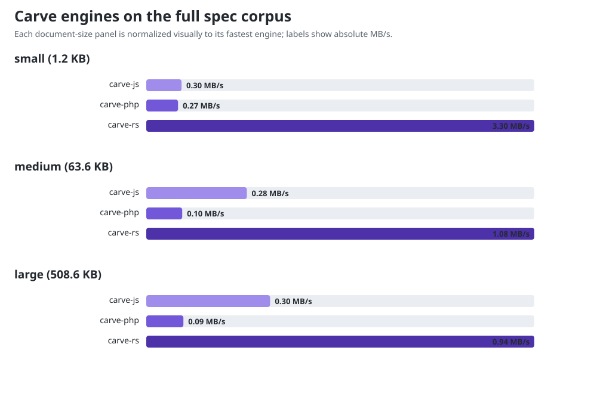
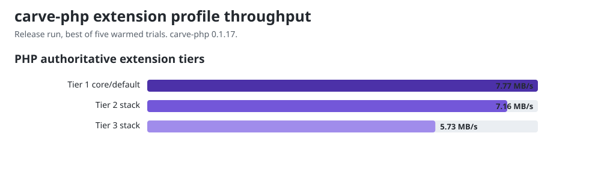

# Benchmark results: authoritative/full parser

This is **Track B**, the Carve-owned authoritative/full-parser view. The mixed
corpus falls outside the conservative borrowed facades and therefore exercises
normal AST construction, extension-capable parsing, and rendering. It answers
how the three Carve implementations scale on their full language, not how their
fastest core-only convenience API compares with another library.

For **Track A**, the primary core source-to-HTML comparison against the
same-language libraries, see [`COMPARISON.md`](../COMPARISON.md).

Parse + render to HTML, in-process, averaged over many iterations. Lower
ms/op and higher MB/s are better. `rel` is relative to the fastest engine for
that document (1.00x = fastest). Numbers are machine-specific - run it yourself
with `node run.mjs`; see README for setup.

Allowed CPUs: 11. Child processes inherit this affinity, including Node compiler and GC threads.

Measured 2026-11-12 UTC on Linux 7.3.0, Node.js 26.12.1, PHP 8.5.12 tracing JIT, and rustc 1.99.1. One-minute host load was 4.60 at start and 6.43 at end on 12 CPUs; other jobs shared the host, so compare engines within this run rather than against the 26 October report. carve-php ran with `memory_limit=512M`: 0.1.17 peaks at 152 MB on the large document, above the 128 MB default.

**Engines measured:** carve-js `@markup-carve/carve 0.1.16 (npm package)`, carve-php `markup-carve/carve-php 0.1.17 (Composer package, reference fa017b5e)`, carve-rs `carve-lang 0.1.14 (crates.io, checksum 88eea74f39e1bd61)`

## small (1.2 KB)

| Engine | ms/op | MB/s | rel |
|---|---:|---:|---:|
| carve-js | 3.8574 | 0.30 | 10.83x |
| carve-php | 4.3765 | 0.27 | 12.28x |
| carve-rs | 0.3563 | 3.30 | 1.00x |

## medium (63.6 KB)

| Engine | ms/op | MB/s | rel |
|---|---:|---:|---:|
| carve-js | 225.3034 | 0.28 | 3.91x |
| carve-php | 639.3297 | 0.10 | 11.09x |
| carve-rs | 57.6646 | 1.08 | 1.00x |

## large (508.6 KB)

| Engine | ms/op | MB/s | rel |
|---|---:|---:|---:|
| carve-js | 1654.6125 | 0.30 | 3.13x |
| carve-php | 5544.3144 | 0.09 | 10.47x |
| carve-rs | 529.3931 | 0.94 | 1.00x |

## PHP authoritative extension tiers

These are internal Carve measurements over the same core document, measured
by this run rather than transcribed. Tier 1 is the default public conversion
route; Tier 2 and Tier 3 register opt-in extensions on top of it. Since
carve-php #1515 made configured conversion allocation-light, registering an
extension no longer forces a wholly separate slow path, so these rows read as
registration and hook costs on a document whose content does not trigger
the registered extensions. Shared host noise can affect ratios, including
apparent negative overhead. These are internal diagnostics, not competitor rows.

| Profile | Registered extensions | ms/op | MB/s | cost vs Tier 1 |
|---|---:|---:|---:|---:|
| Tier 1 core/default | 0 | 6.05 | 7.77 | baseline |
| Tier 2 stack | 8 | 6.56 | 7.16 | +9% |
| Tier 3 stack | 20 | 8.19 | 5.73 | +35% |

The exact extension bundles and interpretation are documented in
[`FINDINGS.md`](../FINDINGS.md#extension-tier-cost). There is no normative Tier
3 profile; it is a reproducible internal stress stack.

## Why Track B has no competitor rows

The corpus uses Carve syntax and capabilities that peer libraries do not
accept equivalently. Feeding it to Djot/CommonMark parsers would benchmark
literal/error recovery rather than the same work. Track A therefore uses
equivalent native-language fixtures for competitors.
